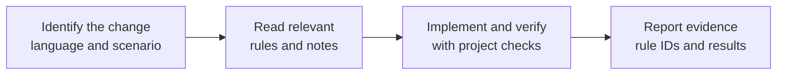

# Secure Coding Skill

**Bring security rules into AI-assisted coding: look up the applicable rules first, write the code, then verify the change with the project's own checks.**

[简体中文](README.md) · **English**

[](https://github.com/yuhengqin/secure-coding-skill/actions/workflows/validate.yml) [](README.md#支持范围) [](README.md#支持范围) [](LICENSE)

AI coding assistants write code fast, but they do not reliably apply secure-coding rules: whether inputs get validated, SQL gets parameterized, or access gets authorized is left to the model's discretion, and things slip through. This repository packages the [Tencent/secguide](https://github.com/Tencent/secguide) secure coding guidelines as an on-demand Agent Skill: before coding, the assistant retrieves the applicable rules; after coding, it self-reviews the final diff against them. Every rule ships with its original text, line numbers, and a source hash. The skill package works offline, and its local CLI has no third-party dependencies.

> The guideline texts themselves are in Chinese. The installation and CLI steps below work in English, but applying the rules requires understanding their original text. The Chinese [README](README.md) remains the primary and most detailed entry point.

## Features

- **225 rules across 5 languages**: Python, JavaScript, Java, Go, C/C++ (TypeScript reuses the JavaScript rules)
- **On-demand loading**: the skill directs the assistant to read the common entry, the language index, and rule bodies relevant to the current change, without loading all five guidelines
- **Traceable**: every rule includes its original text, line numbers, and source hash; 10 sourced applicability notes supplement outdated advice
- **Offline tooling**: search and integrity-check CLI built solely on the Python 3.10+ standard library
- **Tested**: 7 tool regression tests plus a runnable order-query example with 6 behavior tests; CI matrix configured for Windows / Ubuntu × Python 3.10 / 3.14

For developers using Codex CLI / IDE; any client that discovers skills under `.agents/skills/` can install it too (auto-discovery is not yet verified per client, see the [verification table](README.md#验证状态与边界)).

## How it works



For example, an assistant changing only a Go interface can follow the skill instructions to read the common entry, the Go index, and relevant rule bodies without loading the other four guidelines. The assistant selects the rules; the `guide.py` CLI validates the complete rule package locally and returns only what was requested. Actual skill activation still depends on the client.

## Install

### Option A: agent-assisted (Codex CLI / IDE)

After downloading or cloning this repository, open Codex in your target project, replace the path below with the actual absolute path of this repo, and send:

> Please read `<absolute path of this repo>/README_AI.md` and install secure-coding completely into this project's `.agents/skills/secure-coding/`. Keep existing configuration and local modifications, run the available installation checks, and report the result.

[README_AI.md](README_AI.md) gives the installing agent target confirmation, full-copy, conflict-handling, and verification steps. The `skills/` directory here is the distribution copy; downloading alone installs nothing.

### Option B: manual copy (any client with an `.agents/skills/` convention)

For a new installation, replace the target path below with your project's absolute path. If the skill already exists there, compare the version and local changes before updating it.

```sh
git clone https://github.com/yuhengqin/secure-coding-skill.git
TARGET_PROJECT="/absolute/path/to/your-project"
mkdir -p "$TARGET_PROJECT/.agents/skills"
cp -R secure-coding-skill/skills/secure-coding "$TARGET_PROJECT/.agents/skills/"
```

On Windows PowerShell, after cloning:

```powershell
$targetProject = 'C:\path\to\your-project'
New-Item -ItemType Directory -Path "$targetProject\.agents\skills" -Force | Out-Null
Copy-Item -LiteralPath '.\secure-coding-skill\skills\secure-coding' -Destination "$targetProject\.agents\skills" -Recurse
```

Keep the complete directory, including `LICENSE`, `NOTICE.md`, and all subdirectories — do not copy `SKILL.md` alone. With Python 3.10+, verify from the target project root:

```sh
python .agents/skills/secure-coding/scripts/guide.py check
```

Expected: 225 rules, 6 sources, 10 interpretations validated. Reading rules needs nothing installed; the CLI needs Python 3.10+ (standard library only).

## Use it

> Use the secure-coding skill for this Go interface change. Read the applicable rules for the inputs, database, and file operations involved, then report the rule IDs, what you did, and the checks you actually ran.

Codex CLI / IDE also supports explicit `$secure-coding`. If the skill does not appear, reopen the project or restart the client; automatic selection still depends on the client and task context. More prompt examples (in Chinese) for feature work, fixes, and read-only review: [examples/USAGE.md](examples/USAGE.md).

## Example

A request like "implement order lookup for a Python service; reuse the existing login state; users may only read their own orders" resolves to four rules — input validation `PY-BACKEND-1.1.1`, parameterized queries `PY-BACKEND-1.2.1`, authentication by default `PY-BACKEND-1.8.1`, and access-control checks `PY-BACKEND-1.8.3` — and lands in code like:

```python
# authenticated_user_id comes from the server-side verified login state.
# The full function also rejects missing/invalid user IDs and order IDs.
return connection.execute(
    "SELECT id, note FROM orders WHERE id = ? AND user_id = ?",
    (order_id, authenticated_user_id),
).fetchone()
```

Bound parameters keep input as data; the `user_id` condition scopes the order to its owner. The shipped tests verify that another user's order and a nonexistent order return `None`, that injection-shaped input like `order-b' OR 1=1 --` does not widen the query, and that legal IDs containing quotes still work. Run them from the repository root (Python 3.10+ with the stdlib `sqlite3`):

```sh
python -B -m unittest discover -s examples/order-query -p test_orders.py -v
```

Local result: 6 tests pass. This verifies the query function's behavior; the caller remains responsible for authentication and operation-level authorization, and no HTTP service is wired up. Full rule-to-code walkthrough (in Chinese): [examples/order-query/README.md](examples/order-query/README.md).

## Scope and limits

| Language | Rules | Scenarios |
|---|---:|---|
| Python | 45 | general, backend |
| JavaScript | 45 | browser, Node.js |
| Java | 49 | Android, backend |
| Go | 37 | general, backend |
| C/C++ | 49 | general secure coding |

- This is a rule pack for coding assistants, not a security scanner: keep running your project's tests, static analysis, and reviews. `guide.py check` validates the package only.
- Verification status — what is actually tested and what is not — is tracked honestly in the [Chinese verification table](README.md#验证状态与边界). Nothing here proves that any model becomes more secure with the skill.
- CI is configured for Windows / Ubuntu × Python 3.10 / 3.14; the first run was rejected before any step started due to a GitHub account billing lock, so remote execution is still pending.

## License and attribution

Original work: **Secure Coding Guide** by **THL A29 Limited, a Tencent company**, Copyright (C) 2021, from [Tencent/secguide](https://github.com/Tencent/secguide), licensed **CC BY-SA 4.0**. This project is an independent community packaging, not endorsed by Tencent. See [LICENSE](LICENSE), [THIRD_PARTY_NOTICES.md](THIRD_PARTY_NOTICES.md), and [docs/PROVENANCE.md](docs/PROVENANCE.md). When copying the skill directory, keep its `LICENSE`, `NOTICE.md`, and source files.

---

Find it useful? A star helps others find it. Rule corrections and tool bugs: [open an issue](https://github.com/yuhengqin/secure-coding-skill/issues/new/choose) or see [CONTRIBUTING](CONTRIBUTING.md); security-sensitive reports: [SECURITY.md](SECURITY.md).
