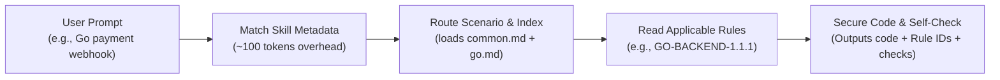

# 🛡️ Secure Coding Skill

<p align="center">
  <b>Eliminate security blind spots in AI coding: Retrieve industrial security rules first, code with defense in depth, and verify before shipping.</b>
</p>

<p align="center">
  <b>English</b> · <a href="./README.zh-CN.md">简体中文</a>
</p>

<p align="center">
  <a href="#quickstart">Quickstart</a> •
  <a href="#why">Why This Skill</a> •
  <a href="#features">Features</a> •
  <a href="#how-it-works">How It Works</a> •
  <a href="#case">Case Study</a> •
  <a href="#languages">Languages</a> •
  <a href="#faq">FAQ</a>
</p>

<p align="center">
  <a href="#languages"></a>
  <a href="#languages"></a>
  
  <a href="LICENSE"></a>
</p>

---

> [!NOTE]
> The upstream guideline texts — and therefore rule details and most in-repo docs — are currently in Chinese. Installation (including the skills CLI one-liner), the offline tooling and this README work in English; the Chinese [README.zh-CN.md](./README.zh-CN.md) carries the most detailed documentation.

---

<span id="why"></span>
## ⚡ Why This Skill? (Before & After)

AI coding assistants write code remarkably fast, but **rarely apply defensive security by default**: input validation, parameterized queries, and authorization checks are left to model chance, frequently producing high-severity vulnerabilities like SQL injection and Broken Object Level Authorization (IDOR).

Dumping hundreds of pages of security rules into your prompt? **It blows up your context window, spikes token costs, and degrades reasoning quality.**

**Secure Coding Skill** packages [Tencent/secguide](https://github.com/Tencent/secguide) (battle-tested across millions of lines of production code) into an open **Agent Skill** using progressive disclosure:

```diff
# Scenario: Query order details by order_id

- Default AI-generated code (High risk: string concatenation SQLi + horizontal privilege escalation)
- return connection.execute(f"SELECT * FROM orders WHERE id = '{order_id}'").fetchone()

+ With secure-coding skill (adhering to PY-BACKEND-1.2.1 and 1.8.3)
+ # Validated input + Parameterized binding + Server-side ownership check
+ return connection.execute(
+     "SELECT id, note FROM orders WHERE id = ? AND user_id = ?",
+     (order_id, authenticated_user_id),
+ ).fetchone()
```

---

<span id="features"></span>
## 💡 Core Features

- 🎯 **225 Industrial Rules**: Comprehensive coverage across Python, JavaScript/TypeScript, Java, Go, and C/C++.
- ⚡ **Zero Context Bloat**: Employs progressive disclosure. Idle skills consume only ~100 tokens; rule bodies are loaded on-demand based on the language and operation touched.
- 🔍 **Full Traceability**: Every rule preserves its upstream line number, markdown body, and SHA-256 source hash, accompanied by 10 modern applicability notes.
- 🔌 **Zero External Dependencies**: CLI tooling relies strictly on the Python 3.10+ standard library. Completely offline and private.
- 🧪 **Verifiable Quality**: Shipped with 7 CLI regression tests and 6 executable behavioral tests (covering SQLi and IDOR defenses); the installed package can be re-verified offline at any time.

---

<span id="quickstart"></span>
## 🚀 Quickstart in 2 Steps

### Step 1: Install the Skill into Your Project

Run commands inside your **target project root directory**.

#### Option 1: skills CLI (Recommended)

```bash
npx skills add yuhengqin/secure-coding-skill
```

The [skills CLI](https://github.com/vercel-labs/skills) detects the coding agents installed on your machine (Codex, Claude Code, Cursor, OpenCode, GitHub Copilot, and many more) and installs the complete `secure-coding` package into the skills directory each agent expects. Requires Node.js (npx); Python is not required for installation.

- Preview before installing: `npx skills add yuhengqin/secure-coding-skill --list`
- Target specific agents: append `--agent codex --agent claude-code`
- Install for all projects on this machine: append `-g`
- Update / remove later: `npx skills update secure-coding` · `npx skills remove secure-coding`

#### Option 2: Terminal clone (no Node required)

**Linux / macOS:**
```bash
git clone --depth 1 https://github.com/yuhengqin/secure-coding-skill.git .tmp-skill \
  && mkdir -p .agents/skills \
  && cp -R .tmp-skill/skills/secure-coding .agents/skills/ \
  && rm -rf .tmp-skill
```

**Windows PowerShell:**
```powershell
git clone --depth 1 https://github.com/yuhengqin/secure-coding-skill.git .tmp-skill
New-Item -ItemType Directory -Path ".agents\skills" -Force | Out-Null
Copy-Item -LiteralPath ".\.tmp-skill\skills\secure-coding" -Destination ".agents\skills" -Recurse
Remove-Item -Path ".\.tmp-skill" -Recurse -Force
```

<details>
<summary><b>Alternative install methods (Agent-assisted / Global / Other clients / Manual)</b></summary>

- **Agent-assisted (Codex / Claude Code / Cursor)**: after cloning, instruct your agent using [README_AI.md](README_AI.md) (Chinese).
- **Global installation (all projects on this machine)**: `npx skills add yuhengqin/secure-coding-skill -g`, or copy manually to:
  - Linux/macOS: `~/.agents/skills/secure-coding/`
  - Windows: `%USERPROFILE%\.agents\skills\secure-coding\`
- **Other clients**: install into the skills directory your client documents (e.g. `.claude/skills/` for Claude Code) — the skills CLI already knows these paths.
- **Manual copy**: copy the entire `skills/secure-coding` directory (including `SKILL.md`, `LICENSE`, `NOTICE.md`, `references/`, `sources/`, `scripts/`, and `tests/`).

</details>

---

### Step 2: Invoke in Your Coding Prompts

Whenever you ask your AI assistant (Codex, Claude Code, Cursor, Windsurf, Copilot, etc.) to write sensitive code:

> **📋 Ready-to-use Prompt:**
> 
> "Please use the `secure-coding` skill for this change. Retrieve relevant input validation, data persistence, and authorization rules first, then report the applicable rule IDs, your implementation defenses, and the checks you ran."

*(In tools supporting explicit tagging, you can also mention `$secure-coding` or `@secure-coding`)*

---

### Verify the Installation

Run from your project root (requires Python 3.10+, standard library only). Use the path of the installed skill — e.g. `.agents/skills/secure-coding` (Codex, Cursor, OpenCode) or `.claude/skills/secure-coding` (Claude Code):

```bash
python .agents/skills/secure-coding/scripts/guide.py check
```

> **Expected output:** a JSON report with `"status": "ok"` — `225 rules, 6 sources, 10 interpretations`.

---

<span id="how-it-works"></span>
## 🛠️ How It Works: Zero Context Bloat



Only the rules for the language(s) your change touches are read — the five guides are never loaded in full. Rule selection is model-driven; the local `guide.py` script can return any rule's body and provenance offline.

---

<span id="case"></span>
## 🧪 Case Study: Order Query

[examples/order-query](examples/order-query/README.md) implements a defensive Python order-lookup function end-to-end (rules → code → tests):

- **Rules applied**: `PY-BACKEND-1.1.1` (input validation), `PY-BACKEND-1.2.1` (parameterized queries), `PY-BACKEND-1.8.1` (default authorization), `PY-BACKEND-1.8.3` (anti-IDOR ownership check).
- **Verified defensive behavior** (6 executable tests):

| Input / scenario | Expected behavior | Status |
| :--- | :--- | :---: |
| User queries their own order | Order details returned | ✅ Pass |
| An order owned by someone else / nonexistent | Returns `None` — no unauthorized access | ✅ Pass |
| Malicious input `order-b' OR 1=1 --` | Parameter binding keeps it plain data; query scope unchanged | ✅ Pass |
| Legitimate ID containing a quote | Handled literally and found normally | ✅ Pass |
| Missing / forged identity, malformed order ID | Rejected before any query is issued | ✅ Pass |

Run the case from this repository root (Python 3.10+, stdlib `sqlite3`):

```bash
python -B -m unittest discover -s examples/order-query -p test_orders.py -v
```

> Note: the function assumes its caller has already authenticated the user. Caller-side authentication, operation-level authorization, and HTTP integration are intentionally out of scope for the example.

---

<span id="languages"></span>
## 📊 Supported Languages & Focus

| Language | Rules | Primary Scenarios | Key Defensive Focus |
| :--- | :---: | :--- | :--- |
| **Python** | 45 | General, Backend APIs | SQLi, SSRF, unsafe deserialization, authorization bypass |
| **JavaScript / TS** | 45 | Frontend Browser, Node.js | XSS, prototype pollution, DOM security, CORS |
| **Java** | 49 | Spring, Android Apps | Expression injection (SpEL), XXE, cryptographic suites |
| **Go** | 37 | High concurrency, microservices | Path traversal, command injection, race safety, memory limits |
| **C / C++** | 49 | Systems, native modules | Buffer overflow, integer overflow, format strings, use-after-free |

> 💡 *Note: TypeScript reuses the JavaScript runtime rules. Upstream "MUST / SHOULD / RECOMMENDED" levels are preserved; the package adds **10 sourced applicability interpretations** for historically outdated guidance.*

---

<span id="faq"></span>
## ❓ FAQ

<details>
<summary><b>Q1: Does this drastically increase API token costs?</b></summary>
No. When idle, the skill costs only ~100 tokens for discovery. When invoked, it loads only the rule bodies relevant to the touched language and operations.
</details>

<details>
<summary><b>Q2: Can I use this in projects without Python?</b></summary>
Yes. The rules are structured Markdown files that agents can read directly. The <code>guide.py</code> script is purely an offline utility for lookup and integrity checking.
</details>

<details>
<summary><b>Q3: Can this replace scanners like SonarQube or Snyk?</b></summary>
No. This skill operates at generation time to prevent bad code before it is written. Upstream CI static analysis, dynamic scans, and human code review remain indispensable.
</details>

<details>
<summary><b>Q4: Which AI coding tools are supported?</b></summary>
Install with the skills CLI (<code>npx skills add yuhengqin/secure-coding-skill</code>) to cover Codex, Claude Code, Cursor, OpenCode, GitHub Copilot, and dozens of other agents automatically. Any other client that can read a skill folder or workspace rules can use the same Markdown files manually. Auto-discovery and trigger sensitivity vary by client, so explicit invocation is recommended; end-to-end triggering has not yet been verified for every client.
</details>

<details>
<summary><b>Q5: How do I update or remove an installed skill?</b></summary>
For skills CLI installs: <code>npx skills update secure-coding</code> and <code>npx skills remove secure-coding</code>. For manual installs: replace the skill directory with the new version, or delete it. Run <code>guide.py check</code> after updating to confirm package integrity. Always keep the package complete — don't copy or delete individual language folders.
</details>

---

## ✅ Validation Status & Scope

This repository sticks to verifiable claims:

| Check | Current status & evidence |
| :--- | :--- |
| Rules package integrity & CLI | Verified locally on Windows / Python 3.14.2: `guide.py check` exits 0 (225 rules, 6 sources, 10 interpretations) |
| skills CLI install path | Verified 2026-10-16: `npx skills add yuhengqin/secure-coding-skill` discovers the skill and installs the complete package (25/25 files hash-identical to this repository); the installed copy passes `guide.py check` |
| Test suites | 7 CLI regression tests + 6 case-study tests pass locally (Windows / Python 3.14.2) |
| Offline & privacy | Rule lookup and integrity checks make no network requests, need no third-party packages, and collect no code |
| Remote CI matrix (Windows / Ubuntu × Python 3.10 / 3.14) | Configured; the first remote run was blocked by a GitHub billing lock before any job started — pending a re-run |
| Client auto-discovery & auto-triggering | Not yet verified end-to-end; explicit invocation is recommended |

Full records and commands: [docs/VALIDATION.md](docs/VALIDATION.md) · [docs/USAGE.md](docs/USAGE.md).

---

## 🗺️ Roadmap

- First green remote CI run, plus end-to-end verification of client discovery and triggering (including the skills CLI install path).
- Single-language export: install only the rule subset for the languages you use.
- Expand the applicability interpretations, continuing to reconcile historical guidance with current frameworks and APIs.
- Additional client adapters (e.g. Claude Code plugin marketplace packaging).

Contributions and reports are welcome — see [CONTRIBUTING.md](CONTRIBUTING.md).

---

## 📚 Docs & Repository Layout

- [Command reference & usage manual](docs/USAGE.md)
- [Prompt templates & review examples](examples/USAGE.md)
- [Provenance & upstream tracking](docs/PROVENANCE.md)
- [Validation records](docs/VALIDATION.md)
- [Maintenance](docs/MAINTENANCE.md) · [Releasing](docs/RELEASING.md)
- [Changelog](CHANGELOG.md) · [AI-assisted install guide](README_AI.md)

*(Most documents under `docs/` and `examples/` are currently in Chinese.)*

```
skills/secure-coding/     # the installable skill package (install in full)
├── SKILL.md              # agent entry point & usage instructions
├── references/           # routing, per-language indexes, interpretations
├── sources/              # byte-verified upstream guideline snapshots
├── scripts/guide.py      # offline CLI: list / show / check / build
└── tests/                # 7 CLI regression tests
examples/order-query/     # runnable case + 6 behavioral tests
docs/                     # usage, validation, provenance, maintenance
.github/workflows/        # CI matrix (validate.yml)
```

---

## 📜 Attribution & License

- **Original work**: **Secure Coding Guide** by **THL A29 Limited, a Tencent company**, Copyright (C) 2021. Upstream repo: [Tencent/secguide](https://github.com/Tencent/secguide).
- **License**: Distributed under **CC BY-SA 4.0**, preserving the upstream [LICENSE](LICENSE).
- **Disclaimer**: This is an independent open-source packaging not officially endorsed by Tencent. Sourced modifications and provenance are recorded in [THIRD_PARTY_NOTICES.md](THIRD_PARTY_NOTICES.md) and [docs/PROVENANCE.md](docs/PROVENANCE.md).

---

<p align="center">
  Find this helpful? Give it a ⭐️ <b>Star</b> to support the project!<br>
  Contributions, rule updates, and discussions are welcome via <a href="https://github.com/yuhengqin/secure-coding-skill/issues">Issues</a> and <a href="CONTRIBUTING.md">Pull Requests</a>.
</p>
