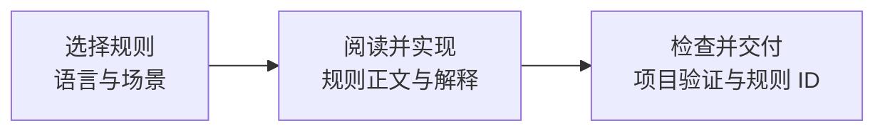

# Secure Coding Skill

**把安全规则带进 AI 编码过程：先查适用规则，再写代码，最后用项目检查验证改动。**

[快速开始](#快速开始) · [实际案例](#实际案例) · [支持范围](#支持范围) · [常见问题](#常见问题) · **[English](README.en.md)**

[](https://github.com/yuhengqin/secure-coding-skill/actions/workflows/validate.yml) [](#支持范围) [](#支持范围) [](LICENSE)

AI 编码助手写代码很快，但不会自动套用安全编码规则——输入是否校验、查询是否参数化、权限是否在服务端验证，全凭模型自觉，容易漏。本仓库把 [Tencent/secguide](https://github.com/Tencent/secguide) 的安全编码指南封装成可按需读取的 Agent Skill：写码前让助手检索适用规则，写完对照规则自查改动。每条规则带原文出处与来源哈希；技能包可离线使用，本地 CLI 无第三方依赖。

## 特性

- **225 条规则、5 种语言**：Python、JavaScript、Java、Go、C/C++；TypeScript 复用 JavaScript 运行时规则
- **按需加载**：技能指示助手只读本次改动涉及的共性入口、语言索引和规则正文，无需把五份指南全文塞进上下文
- **可追溯**：规则正文、原文行号与来源哈希随包提供，另附 10 项带出处的适用性解释
- **离线工具**：规则检索与完整性校验 CLI 只用 Python 3.10+ 标准库，不联网、无第三方依赖
- **可验证**：随包 7 项工具回归测试与 6 项可运行案例测试；CI 矩阵配置为 Windows / Ubuntu × Python 3.10 / 3.14

写给使用 Codex CLI / IDE 的开发者；其他支持 `.agents/skills/` 技能目录的客户端也可安装（自动发现与触发尚未逐一验证，见[验证状态](#验证状态与边界)）。

## 工作方式



例如只改 Go 接口时，助手可按技能说明读取共性入口、Go 索引和相关正文，无需把其他四种语言的指南全文放进上下文。规则选择由助手执行；`guide.py` 检索脚本在本地校验完整规则库，只返回请求的结果。安装后，助手可按 [SKILL.md](skills/secure-coding/SKILL.md) 中的流程使用它；实际触发仍取决于客户端。

## 快速开始

### 方式 A：让助手安装（Codex CLI / IDE）

下载或克隆本仓库后，在目标业务项目中打开 Codex，把下面的路径替换为本仓库的实际绝对路径，然后发送：

> 请阅读 `<本仓库绝对路径>/README_AI.md`，将 secure-coding 完整安装到当前项目的 `.agents/skills/secure-coding/`。保留已有配置和本地修改，完成可用的安装检查并报告结果。

[README_AI.md](README_AI.md) 为安装助手提供目标确认、完整复制、冲突处理和验证步骤。本仓库中的 `skills/` 是分发目录，下载本身不会把技能安装到其他项目。

### 方式 B：手动复制（任何支持 `.agents/skills/` 目录的客户端）

以下命令用于新安装；先把目标路径改成你的项目绝对路径。目标已有同名技能时，先比较版本和本地修改，再决定如何更新。

```sh
git clone https://github.com/yuhengqin/secure-coding-skill.git
TARGET_PROJECT="/absolute/path/to/your-project"
mkdir -p "$TARGET_PROJECT/.agents/skills"
cp -R secure-coding-skill/skills/secure-coding "$TARGET_PROJECT/.agents/skills/"
```

Windows PowerShell 在克隆后使用：

```powershell
$targetProject = 'C:\path\to\your-project'
New-Item -ItemType Directory -Path "$targetProject\.agents\skills" -Force | Out-Null
Copy-Item -LiteralPath '.\secure-coding-skill\skills\secure-coding' -Destination "$targetProject\.agents\skills" -Recurse
```

保留完整目录及 `LICENSE`、`NOTICE.md` 与全部子目录，不要只复制 `SKILL.md`。

### 用它完成一次改动

> 请使用 secure-coding 技能完成这次 Go 接口改动。根据涉及的输入、数据库和文件操作读取适用规则，并在完成后说明规则 ID、处理结果及实际执行的验证。

Codex CLI / IDE 也支持显式提及 `$secure-coding`。若技能未出现，重新打开项目或重启客户端；自动选择仍取决于客户端和任务上下文。更多[功能开发、修改与只读审查示例](examples/USAGE.md)。

### 检查安装

有 Python 3.10+ 时，在**目标业务项目根目录**运行：

```sh
python .agents/skills/secure-coding/scripts/guide.py check
```

预期校验 **225 条规则、6 份来源、10 项解释**。这一步检查包完整性；实际编码交付还应包含规则对应的代码位置、项目测试结果和未验证事项。没有 Python 时仍能按索引阅读 Markdown，检索和完整性校验脚本暂不可用。

<details>
<summary>个人全局安装、项目入口与 Skill Installer</summary>

希望适用于个人所有项目时，将完整目录放到 `~/.agents/skills/secure-coding/`（Windows 为 `%USERPROFILE%\.agents\skills\secure-coding\`）。避免在同一环境重复安装同名技能。

可在项目 `AGENTS.md` 中合并[项目入口模板](examples/AGENTS.md)的段落，保留其他指令。

提供 `skill-installer` 的 Codex 环境也可使用以下请求，填写实际 GitHub 仓库地址：

> 使用 skill-installer，从 `<仓库 GitHub 地址>` 安装 `skills/secure-coding` 目录中的技能。

目录与发现机制见 [Codex 官方文档](https://learn.chatgpt.com/docs/build-skills)。其他助手需按其文档配置技能目录；客户端适配状态见下方验证表。

</details>

## 实际案例

> 为 Python 服务实现订单查询：沿用已有登录态，用户只能读取自己的订单；检查输入、SQL 查询和权限边界，并完成相关测试。

助手读取输入校验 `PY-BACKEND-1.1.1`、参数化查询 `PY-BACKEND-1.2.1`、默认鉴权 `PY-BACKEND-1.8.1`、防越权 `PY-BACKEND-1.8.3` 四项规则正文后，落实到代码中的关键查询：

```python
# authenticated_user_id 由调用方从服务端已验证的登录态取得。
# 完整函数还会拒绝缺失/无效的用户 ID，以及不符合长度约定的订单 ID。
return connection.execute(
    "SELECT id, note FROM orders WHERE id = ? AND user_id = ?",
    (order_id, authenticated_user_id),
).fetchone()
```

参数绑定使输入保持为数据，`user_id` 条件限制订单归属。随包测试验证的行为：

| 输入或情形 | 已验证行为 |
|---|---|
| 本人的订单 | 返回订单 |
| 他人的订单 / 不存在的订单 | 返回 `None` |
| `order-b' OR 1=1 --` | 不扩大查询范围 |
| 合法 ID 含单引号 | 按字面值正常查询 |
| 缺失/无效身份、无效订单 ID | 拒绝查询 |

在本仓库根目录运行（Python 3.10+，标准库 `sqlite3`）：

```sh
python -B -m unittest discover -s examples/order-query -p test_orders.py -v
```

**本地结果：6 项测试通过。** 这是查询函数的行为验证；调用方仍负责认证与操作权限，尚未接入 HTTP 服务。完整的规则到实现对照与可运行代码见[订单查询案例](examples/order-query/README.md)。

## 支持范围

适用于功能开发、缺陷修复、重构和只读代码审查；按本次代码涉及的语言与运行环境选择规则。

| 语言 | 规则数 | 场景 |
|---|---:|---|
| Python | 45 | 通用、服务端 |
| JavaScript | 45 | 浏览器、Node.js |
| Java | 49 | Android、服务端 |
| Go | 37 | 通用、服务端 |
| C/C++ | 49 | 通用安全编码 |

TypeScript 复用适用的 JavaScript 运行时规则，目前没有独立的 TypeScript 规则库。原文中的“必须／建议／推荐”保持原级别；另提供 **10 项带出处的适用性解释**，补充部分历史建议的使用条件。

## 常见问题

**只写 Go，会加载全部语言吗？** 通常只读共性入口、Go 索引及相关正文。按需选择由助手执行，并非程序强制的访问隔离。

**必须安装 Python 吗？** 阅读规则不需要。检索、构建和完整性校验需要 Python 3.10+，仅用标准库，无第三方依赖。

**安装后一定会自动触发吗？** 自动选择取决于客户端、技能描述和任务上下文。先用“请使用 secure-coding 技能”显式调用，并检查它是否实际读取规则；复制成功不代表触发已验证。

**可以删掉不用的语言吗？** 当前请保留完整包。来源清单和校验依赖全部指南，尚未提供单语言导出功能。

**能替代安全扫描或代码审查吗？** 不能。它给助手提供可追溯的规则依据，项目测试、静态分析和合并检查仍使用目标项目的工具。`guide.py check` 只检查规则包。

## 验证状态与边界

| 项目 | 当前证据 |
|---|---|
| 规则包、独立复制安装、命令使用 | 已在 Windows / Python 3.14.2 验证 |
| 回归测试与订单示例 | 7 项工具测试 + 6 项示例测试通过 |
| Windows / Ubuntu × Python 3.10 / 3.14 | CI 已配置并触发；首次运行因 GitHub 账户计费锁定未启动，工作流命令已在本地验证，待账户问题解决后重跑 |
| 客户端自动发现、自动触发及其他助手 | 尚未做端到端验证 |

完整命令与证据见 [使用手册](docs/USAGE.md) 和 [验证记录](docs/VALIDATION.md)。原指南含历史版本及正反示例，10 项解释没有覆盖全部 225 条规则的现代化审计；移植示例前应核验当前 API 和运行环境。

## 路线图

- 远程 CI 与客户端自动发现、自动触发的端到端验证
- 单语言导出：按需安装所用语言的规则子集（当前请保留完整包）
- 扩充适用性解释，逐步核对历史建议与当前框架 / API 的匹配
- 其他客户端（如 Claude Code）的安装与触发适配

欢迎按[贡献指南](CONTRIBUTING.md)认领或报告补充。

## 深入阅读

[英文入口](README.en.md) · [安装助手说明](README_AI.md) · [命令与使用手册](docs/USAGE.md) · [贡献指南](CONTRIBUTING.md) · [安全报告](SECURITY.md) · [维护说明](docs/MAINTENANCE.md) · [发布步骤](docs/RELEASING.md) · [更新记录](CHANGELOG.md)

<details>
<summary>仓库结构</summary>

```text
secure-coding-skill/
├── README.md / README.en.md / README_AI.md  # 中文入口 / 英文入口 / 安装助手入口
├── LICENSE / THIRD_PARTY_NOTICES.md / SECURITY.md
├── docs/                    # 使用、来源、维护、验证、发布
├── examples/                # 提示词、项目入口与可运行案例
├── .github/                 # 包与案例的 CI、Issue 模板
└── skills/secure-coding/     # 可完整复制的技能包
    ├── SKILL.md / LICENSE / NOTICE.md
    ├── references/ / sources/
    └── scripts/ / tests/
```

</details>

## 来源与许可

原作：**Secure Coding Guide**，作者及版权方 **THL A29 Limited, a Tencent company**，Copyright (C) 2021。原仓库：[Tencent/secguide](https://github.com/Tencent/secguide)。本项目是独立社区封装，未获得腾讯官方背书。

本仓库按 **CC BY-SA 4.0** 分发，保留上游完整 [LICENSE](LICENSE)。技能指令、索引、解释、工具及文档等修改见 [第三方声明](THIRD_PARTY_NOTICES.md) 和 [来源记录](docs/PROVENANCE.md)。复制技能目录时须保留其中的 `LICENSE`、`NOTICE.md` 及来源文件。

上游 README 的链接标签写作“CC BY 4.0”，但其目标链接和 `LICENSE` 全文是 **CC BY-SA 4.0**；本项目依照许可证全文标注。

---

觉得有用欢迎点一个 Star。规则过时、解释依据不足或工具缺陷，欢迎[提交 Issue](https://github.com/yuhengqin/secure-coding-skill/issues/new/choose)或按[贡献指南](CONTRIBUTING.md)发起 PR；安全问题请按[安全报告](SECURITY.md)说明。
