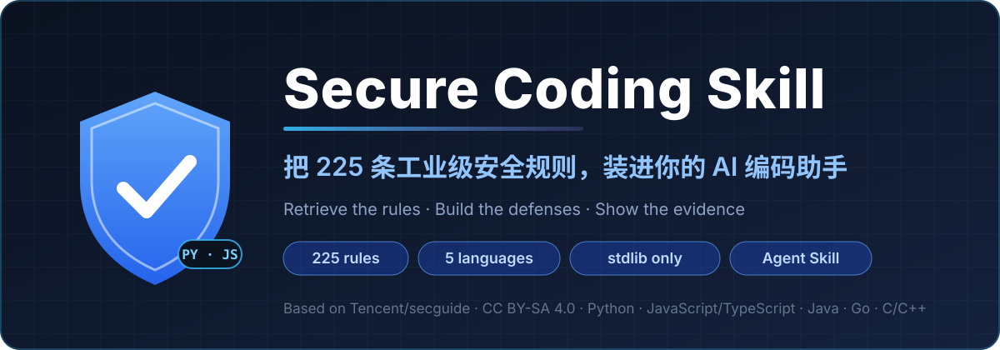

<p align="center">
  
</p>

<h1 align="center">🛡️ Secure Coding Skill</h1>

<p align="center">
  <b>让 AI 写代码时，有安全规则可查，有检查结果可交。<br>225 条规则 · 5 类语言 · 从需求到证据</b>
</p>

<p align="center">
  <b>简体中文</b> · <a href="./README_EN.md">English</a>
</p>

<p align="center">
  <a href="#quickstart">快速上手</a> · <a href="#case">先看效果</a> · <a href="#evidence">验证证据</a> · <a href="#use-cases">适用场景</a> · <a href="#features">核心特性</a> · <a href="#compatibility">客户端兼容</a> · <a href="#repo">仓库结构</a> · <a href="#faq">常见问题</a> · <a href="#roadmap">路线图</a>
</p>

<p align="center">
  <a href="https://github.com/yuhengqin/secure-coding-skill/stargazers"></a>
  <a href="#languages"></a>
  <a href="#languages"></a>
  
  <a href="./docs/VALIDATION.md"></a>
  <a href="https://agentskills.io/specification"></a>
  <a href="./LICENSE"></a>
</p>

**把 Tencent/secguide 的 225 条安全规则，装进你的 AI 编码助手。** 按语言与任务检索适用规则，让实现和审查有依据，交付能对应到**规则 ID、代码位置与实际检查结果**。

在**目标业务项目根目录**运行，按提示选择编码助手：

```bash
npx skills add yuhengqin/secure-coding-skill
```

需要带 `npx` 的 Node.js；也可以[让助手安装](./README_AI.md)，或[手动复制完整包](./docs/INSTALLATION.md)。OpenCode 已验证显式调用；其他客户端见[兼容情况](#compatibility)。

**① 装好技能 → ② 提需求并指定 `secure-coding` → ③ 检查交付中的规则、代码与证据。** [试第一个任务 →](#quickstart)

| 安全规则 | 覆盖语言 | 适用性解释 | 回归测试 | CLI 第三方依赖 |
| :---: | :---: | :---: | :---: | :---: |
| **225** | **5** | **10** | **13（7 + 6）** | **0** |

覆盖 **Python · JavaScript/TypeScript · Java · Go · C/C++**。规则保留“必须／建议／推荐”级别；数字与本地检查记录见[验证文档](./docs/VALIDATION.md)，`check ok` 徽章表示已记录的本地包校验结果。

**代码能跑通，不等于权限边界正确。** 一条订单查询即使功能测试通过，也可能漏掉参数绑定或订单归属限制。这个技能把相关规则带进实现过程，并要求助手说明检查了什么、还没验证什么。

<span id="case"></span>

## 🧪 先看效果：订单只能自己查

[可运行的订单查询案例](./examples/order-query/README.md)：**需求 → 规则 → 实现 → 测试**。下面是按案例编排的**对话示意，非逐字实录，也非模型 A/B 实测**；实际安装与调用记录见[验证证据](#evidence)。

```text
你   ❯ 使用 secure-coding 实现 Python 订单查询：沿用已有登录态，
       用户只能读取自己的订单。

AI   ❯ 先读取 4 条适用规则：
       PY-BACKEND-1.1.1 输入校验 · PY-BACKEND-1.2.1 参数化查询
       PY-BACKEND-1.8.1 默认鉴权 · PY-BACKEND-1.8.3 对象归属
       调用方须完成认证与操作权限检查，传入服务端已验证的身份。

你   ❯ 改在哪里，验证了什么？

AI   ❯ orders.py:17–23 校验输入；25–28 参数绑定并限制订单归属。
       6 项测试通过：本人可查，他人和不存在的订单返回 None；
       注入形态输入不扩大查询，非法身份与订单 ID 被拒绝。
       未验证：HTTP 认证、操作级权限、真实数据库集成。
```

[查看实现 `orders.py`](./examples/order-query/orders.py#L17-L28) · [查看 6 项测试](./examples/order-query/test_orders.py) · [规则与代码对应表](./examples/order-query/README.md#从规则到实现)

<details>
<summary><b>展开：查询前后对比与规则映射</b></summary>

```diff
# 查询写法示意；完整输入校验见 orders.py。

- # 风险写法：直接拼接 SQL，没有订单归属限制
- return connection.execute(f"SELECT * FROM orders WHERE id = '{order_id}'").fetchone()

+ # PY-BACKEND-1.2.1 + PY-BACKEND-1.8.3：参数绑定 + 对象归属检查
+ return connection.execute(
+     "SELECT id, note FROM orders WHERE id = ? AND user_id = ?",
+     (order_id, authenticated_user_id),
+ ).fetchone()
```

| 你会得到什么 | 在这个案例中 |
| :--- | :--- |
| **有依据的规则选择** | `PY-BACKEND-1.1.1` 输入校验；`PY-BACKEND-1.2.1` 参数绑定；`PY-BACKEND-1.8.1` 默认鉴权；`PY-BACKEND-1.8.3` 对象归属 |
| **落到代码里的防护** | 输入校验 + SQL 参数绑定 + 基于服务端已验证身份的订单归属限制 |
| **能亲手复跑的证据** | 6 项测试覆盖本人／他人／不存在的订单、注入形态输入与合法单引号、无效身份值及非法订单 ID |

</details>

**直接跑起来**——在本仓库根目录执行，需要 Python 3.10+ 与标准库 `sqlite3`：

```bash
python -B -m unittest discover -s examples/order-query -p test_orders.py -v
```

案例使用 SQLite 内存数据库，6 项测试已在本地通过；身份数值校验本身不构成认证。[完整实现与边界 →](./examples/order-query/README.md)

<span id="evidence"></span>

## 📡 验证证据：哪些已经跑过

以下为 **2026-10-16、Windows 环境**的验证记录与输出节选。OpenCode 调用和全新安装依据[已有端到端记录](./docs/VALIDATION.md#2026-10-16-端到端调用补记opencodeasiashanghai)；包校验与 13 项测试在本次 README 更新时重新通过。

| 检查 | 结果 | 证明范围 |
| :--- | :--- | :--- |
| `guide.py check` | **ok**：225 条规则、6 份来源、10 项解释 | 规则包完整性 |
| 工具与案例测试 | **7 + 6 项通过** | CLI 回归与订单案例行为 |
| skills CLI 全新安装 | **25/25 文件 SHA-256 一致** | 已记录的安装副本与源包一致 |
| OpenCode 显式调用 | **技能加载成功，完成案例规则审查** | 该客户端的手动指定调用路径 |

<details>
<summary><b>展开：安装、校验、规则检索与测试证据</b></summary>

**① OpenCode 显式调用技能，加载成功：**

```
⏺ skill({"id":"secure-coding"})
  ⏺ Skill "secure-coding" loaded successfully
    Base directory: D:\chat\.agents\skills\secure-coding
```

**② 全新环境安装（skills CLI），25/25 文件与仓库一致：**

```bash
npx -y skills add yuhengqin/secure-coding-skill -a opencode --copy -y
```

验证记录中的安装副本逐文件 SHA-256 与当时仓库一致，并通过完整性校验。

**③ 完整性校验（`guide.py check`）：**

```console
$ python skills/secure-coding/scripts/guide.py check
{
  "status": "ok",
  "rules": 225,
  "by_language": {
    "python": 45,
    "javascript": 45,
    "java": 49,
    "go": 37,
    "cpp": 49
  },
  "sources": 6,
  "interpretations": 10,
  "scope": "package integrity only; not a target-code security scan"
}
```

**④ 规则检索（`guide.py show`），带原文行号与来源哈希（节选，哈希缩写）：**

```console
$ python skills/secure-coding/scripts/guide.py show PY-BACKEND-1.2.1
# PY-BACKEND-1.2.1 [必须] 使用参数化查询
Context: 后台类 / I. 代码实现 / 1.2 SQL操作
Source: sources/Python安全指南.md:177-262 sha256=b1d1f0b7…

Original excerpt (historical examples; apply interpretations and verify applicability):
177  #### 1.2.1 【必须】使用参数化查询
179  - 使用参数化SQL语句，强制区分数据和命令，避免产生SQL注入漏洞。
…
```

**⑤ 测试证据（结果摘要，省略逐项输出与耗时）：**

```console
$ python -B -m unittest discover -s skills/secure-coding/tests -v
Ran 7 tests
OK

$ python -B -m unittest discover -s examples/order-query -p test_orders.py -v
Ran 6 tests
OK
```

</details>

**诚实边界：** 包校验通过不代表业务代码安全；显式调用成功不代表自动触发已验证。尚无受控实验量化模型安全能力提升。远程 CI 状态见[验证范围](#validation)。

<span id="quickstart"></span>

## 🚀 装好后，试一个任务

在首页命令完成安装后，把技能带进一个实际任务。如果项目涉及订单查询，可以直接对助手说：

```text
请使用 secure-coding 技能实现或审查本项目的订单查询。
用户只能读取自己的订单。先检索相关的输入校验、SQL 与权限规则，
完成后说明规则 ID、对应代码位置、防护措施、实际执行的检查及未验证事项。
```

**如何判断用上了：** 助手读取了适用规则，并把结论对应到代码和检查。也可以先让它定位 `secure-coding` 并读取 `PY-BACKEND-1.2.1`；若找不到技能，核对安装目录后重新打开项目。建议显式指定技能名称调用。

<details>
<summary><b>可选：检查安装后的规则包</b></summary>

有 Python 3.10+ 时，在业务项目根目录运行。若客户端使用其他目录，请替换为实际安装路径。

```bash
python .agents/skills/secure-coding/scripts/guide.py check
```

预期返回 `"status": "ok"`，包含 **225 条规则、6 份来源、10 项解释**。这验证包完整性；客户端是否成功调用需单独确认（见上方端到端实测）。

</details>

<details>
<summary><b>更多安装方式、更新与卸载</b></summary>

| 你的需求 | 命令或入口 |
| :--- | :--- |
| 先看看有哪些技能 | `npx skills add yuhengqin/secure-coding-skill --list` |
| 指定客户端 | `npx skills add yuhengqin/secure-coding-skill --agent codex --agent claude-code` |
| 本机所有项目可用 | `npx skills add yuhengqin/secure-coding-skill -g` |
| 更新／卸载项目级安装 | `npx skills update secure-coding` / `npx skills remove secure-coding` |
| 更新／卸载全局安装 | 在更新或卸载命令中追加 `-g` |
| 没有 Node.js | [手动安装：Linux、macOS 与 PowerShell](./docs/INSTALLATION.md) |
| 让助手完成安装 | [AI 安装交接指南](./README_AI.md) |

[skills CLI](https://github.com/vercel-labs/skills) 会处理各客户端的安装位置。手动安装须保留完整 `skills/secure-coding/`，包括许可证和来源文件。更新手动副本前先比较并保留本地修改，更新后运行 `guide.py check`。

</details>

<span id="routing"></span>

<details>
<summary><b>🧭 不知道从哪开始？按角色找入口</b></summary>

| 你是… | 你想… | 去这里 |
| :--- | :--- | :--- |
| 🤖 AI 代理 | 安装、校验、首次调用 | [`README_AI.md`](./README_AI.md) |
| 🤖 AI 代理 | 了解本仓库结构与红线 | [`AGENTS.md`](./AGENTS.md) / [`CLAUDE.md`](./CLAUDE.md) |
| 👤 人类（第一次来） | 试第一个任务 | [快速上手](#quickstart) |
| 👤 人类（用 OpenCode） | 端到端流程与调用方式 | [`docs/USAGE.md`](./docs/USAGE.md) |
| 🔧 想手动安装 | 选客户端、选平台 | [`docs/INSTALLATION.md`](./docs/INSTALLATION.md) |
| 📖 想查某条规则 | 精确检索规则正文 | `guide.py show <规则ID>` |
| 🔍 想验证规则来源 | 核对哈希与出处 | [`docs/PROVENANCE.md`](./docs/PROVENANCE.md) · [`docs/VALIDATION.md`](./docs/VALIDATION.md) |
| 🧩 想维护或发布规则包 | 构建、发布流程 | [`docs/MAINTENANCE.md`](./docs/MAINTENANCE.md) · [`docs/RELEASING.md`](./docs/RELEASING.md) |
| 🤝 想参与贡献 | 开 Issue / PR | [`CONTRIBUTING.md`](./CONTRIBUTING.md) · [Issue 模板](./.github/ISSUE_TEMPLATE) |

</details>

<span id="use-cases"></span>

## 🎯 这些场景，直接叫上它

| 你正在做什么 | 带进改动的规则与检查 |
| :--- | :--- |
| 写 API、查数据库 | 输入校验、参数化查询、身份认证与对象归属 |
| 做上传下载、访问用户提供的 URL | 路径边界、文件约束、SSRF 与重定向处理 |
| 渲染 HTML、修改浏览器行为 | XSS、输出上下文、DOM 操作与浏览器安全边界 |
| 启动进程、反序列化数据 | 命令参数、执行边界与不可信输入 |
| 重构或审查已有代码 | 适用规则 ID、代码证据、针对性检查与未覆盖事项 |

<span id="features"></span>

## 🔍 为什么把规则做成技能

- 🎯 **225 条规则，一次装齐。** Python、JavaScript/TypeScript、Java、Go、C/C++，五类语言收进一个技能包。
- 🪶 **按需读取。** 渐进式披露，沿语言与任务索引读取相关正文，无需一开始载入五份指南全文；尚未量化 token 节省幅度。
- 🔍 **每条规则，都有出处。** 原文、行号、来源 SHA-256 完整可查，另有 10 项带依据的历史建议适用性解释。
- 🔌 **CLI 零第三方依赖。** Python 3.10+ 标准库即可完成本地检索与完整性校验，不联网、不采集代码。
- 🧪 **拿检查结果说话。** 7 项工具回归测试 + 6 项可运行案例测试，执行命令公开，随时亲手复验。

<details>
<summary><b>展开：从需求到证据的检索流程</b></summary>


模型负责选择适用规则，`guide.py` 负责在本地检索正文与出处。应用历史示例时，技能还要求核对当前 API 和项目约束。[查看完整工作流 →](./skills/secure-coding/SKILL.md)

</details>

<span id="languages"></span>

## 📊 语言与覆盖范围

| 语言 | 规则数 | 环境与防御重点 |
| :--- | :---: | :--- |
| **Python** | 45 | 脚本与服务端：SQL 注入、SSRF、反序列化、访问控制 |
| **JavaScript / TypeScript** | 45 | 浏览器与 Node.js：XSS、DOM 安全、原型链污染、CORS |
| **Java** | 49 | 服务端与 Android：表达式注入、XXE、密码学应用 |
| **Go** | 37 | 后端与系统代码：路径、命令、并发与资源限制 |
| **C / C++** | 49 | 原生代码：缓冲区与整数溢出、格式化字符串、内存生命周期 |

TypeScript 复用 JavaScript 运行时规则。225 条包括 **188 条必须、27 条建议、10 条推荐**，不是 225 类漏洞。10 项适用性解释针对特定历史建议，全部规则尚未完成现代化审计。来源为 [Tencent/secguide](https://github.com/Tencent/secguide)。

<span id="compatibility"></span>

## 🔌 客户端兼容情况

| 客户端／安装途径 | 规则包安装 | 技能发现与实际调用 |
| :--- | :--- | :--- |
| **OpenCode，经 skills CLI** | Windows，2026-10-16 实测：`-a opencode --copy -y`，25/25 文件一致，安装副本 `check` 通过 | ✅ 端到端已验证（2026-10-16，显式调用加载成功，见[端到端实测](#evidence)） |
| **Codex、Claude Code、Cursor、GitHub Copilot 等 skills CLI 客户端** | 上游 CLI 提供安装适配，本仓库未逐一实测 | 尚未端到端验证，欢迎提交验证记录 |
| **手动复制** | 已验证完整包复制及安装后的 CLI 使用；目录遵循目标客户端约定 | 取决于客户端加载机制 |

以安装器报告的位置为准。共享项目级路径通常为 `.agents/skills/secure-coding/`，不同客户端可能使用专用路径。[安装详情 →](./docs/INSTALLATION.md) · [验证记录 →](./docs/VALIDATION.md)

<span id="validation"></span>

## ✅ 验证结果，公开可查

| 检查项 | 已记录结果 |
| :--- | :--- |
| 规则包完整性 | **本地通过：** 225 条规则、6 份来源、10 项解释（哈希、覆盖、生成文件全部一致） |
| 工具与案例测试 | Windows / Python 3.14.2 上 **7 + 6 项通过** |
| OpenCode 端到端调用 | **已验证：** 显式调用 `secure-coding` 加载成功（2026-10-16） |
| skills CLI 全新安装 | **已验证：** 25/25 文件哈希一致，安装副本校验通过（2026-10-16） |
| 远程 CI | 已配置 Windows / Ubuntu × Python 3.10 / 3.14；[已记录的首次运行](https://github.com/yuhengqin/secure-coding-skill/actions/runs/38339001315)因账户计费问题未启动 job，尚无通过记录 |
| 模型安全能力提升 | 尚未开展与无技能基线的受控对比 |

包校验和案例测试仅覆盖各自声明的范围；业务项目仍需运行自身的测试、扫描与审查。[执行命令与完整证据 →](./docs/VALIDATION.md)

<span id="repo"></span>

## 🗂️ 仓库结构

<details>
<summary><b>展开目录：技能包、案例与维护文档</b></summary>

```
secure-coding-skill/
├── README.md                  ← 本文件（简体中文，默认首页）
├── README_EN.md               ← English README
├── README_AI.md               ← 给 AI 代理的安装交接入口
├── AGENTS.md / CLAUDE.md      ← 代理仓库导航（Claude / Codex / OpenCode / Cursor）
├── assets/banner.svg          ← 视觉锚点
├── skills/secure-coding/      ← 可安装的完整技能包
│   ├── SKILL.md               ← 技能入口（代理先读这个）
│   ├── scripts/guide.py       ← 零依赖 CLI：check / show / list / build
│   ├── references/            ← 语言索引、场景路由、规则元数据（LLM 按需读取）
│   ├── sources/               ← 来源原文快照 + 溯源清单（manifest / provenance）
│   └── tests/                 ← 7 项工具回归测试
├── examples/order-query/      ← 可运行案例：订单查询（6 项测试）
├── docs/                      ← 安装 / 用法 / 来源 / 验证 / 维护 / 发布
├── .github/workflows/         ← 远程校验工作流
└── THIRD_PARTY_NOTICES.md     ← 第三方声明
```

</details>

<span id="faq"></span>

## ❓ 常见问题

<details>
<summary><b>直接把 secguide 原文丢给 AI 不就行了？为什么还要这个技能？</b></summary>

可以。本技能增加的是可复用的检索和交付约定：按语言与场景找规则，每条带原文行号和 SHA-256，10 项解释补充特定历史建议的适用条件；交付时要求助手对应代码位置，并区分“已检查”与“未验证”。无需每次把五份全文放进上下文，但实际 token 节省尚未测量。这些约定也需要检查助手是否执行。

</details>

<details>
<summary><b>业务项目必须使用 Python 吗？</b></summary>

不必。助手可以直接读取 Markdown 规则；Python 3.10+ 只用于本地检索、包校验与测试。

</details>

<details>
<summary><b>会占用多少上下文？</b></summary>

技能按渐进式披露组织：发现时提供元数据，调用后读取指令、索引和适用规则。实际 token 消耗取决于客户端和任务，本仓库尚未公布实测预算。

</details>

<details>
<summary><b>能替代安全扫描器，或让 AI 客户端完全离线吗？</b></summary>

它指导生成与审查；请保留项目原有的静态分析、动态测试和人工审查。本地 CLI 不联网，编码助手的模型调用和数据处理仍遵循客户端设置及服务商条款。

</details>

<details>
<summary><b>能只安装一种语言吗？</b></summary>

目前请保留完整包，完整性校验覆盖整个规则库；助手仍可选择性读取。单语言导出已列入路线图。

</details>

<details>
<summary><b>规则是 AI 编的吗？</b></summary>

规则来自 secguide 原文，仓库内置原文快照与 SHA-256 哈希，`guide.py check` 逐条校验；每条规则都能定位到原文行号。技能明确要求助手如实报告检查与未验证事项，不把猜测说成通过。

</details>

<span id="roadmap"></span>

## 🤝 一起完善它

欢迎提交**客户端验证记录**、**有当前依据的规则更正**、**包含有效测试的可运行案例**。从[贡献指南](./CONTRIBUTING.md)开始；可利用的工具缺陷请按[安全报告说明](./SECURITY.md)提交。

- ✅ OpenCode 端到端调用验证（2026-10-16 完成）
- ⬜ 完成其余客户端（Claude Code / Codex / Cursor）的实际调用验证
- ⬜ 跑通首个远程 CI，发布带版本号的 Release
- ⬜ 扩充有来源的适用性解释与可运行案例
- ⬜ 探索单语言导出和更多客户端适配

## 📚 继续探索

| 你想了解什么 | 从这里开始 |
| :--- | :--- |
| 让 AI 助手完成安装 | [AI 安装交接指南](./README_AI.md) · [代理导航](./AGENTS.md) |
| 手动安装 | [安装指南](./docs/INSTALLATION.md) |
| 检索规则、执行检查 | [命令与使用手册](./docs/USAGE.md) |
| 更多开发与审查提示词 | [使用示例](./examples/USAGE.md) |
| 原始来源与封装修改 | [来源追溯](./docs/PROVENANCE.md) · [第三方声明](./THIRD_PARTY_NOTICES.md) |
| 维护与发布 | [维护说明](./docs/MAINTENANCE.md) · [发布步骤](./docs/RELEASING.md) · [更新记录](./CHANGELOG.md) |

可安装的完整技能包位于 `skills/secure-coding/`，可运行案例位于 `examples/order-query/`。大部分配套文档使用中文。

## 📜 来源与开源协议

基于 **THL A29 Limited, a Tencent company** 的 **Secure Coding Guide**，Copyright (C) 2021。按 **[CC BY-SA 4.0](./LICENSE)** 分发，保留原作署名与修改说明（见 [NOTICE](./skills/secure-coding/NOTICE.md)）。本项目为独立社区封装，未获得腾讯官方背书。安装包须保留 `LICENSE`、`NOTICE.md` 及来源文件。

<p align="center">
  下一次让 AI 写代码，就把安全一起带上。<br>
  如果它帮到了你，欢迎点亮 ⭐️ <b>Star</b>、分享真实案例，或 <a href="https://github.com/yuhengqin/secure-coding-skill/issues/new/choose">提交问题</a>。
</p>
