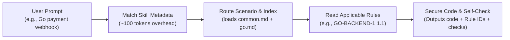

# 🛡️ Secure Coding Skill

<p align="center">
  <b>Eliminate security blind spots in AI coding: Retrieve industrial security rules first, code with defense in depth, and verify before shipping.</b>
</p>

<p align="center">
  <b>English</b> · <a href="./README.zh-CN.md">简体中文</a>
</p>

<p align="center">
  <a href="#quickstart">Quickstart</a> •
  <a href="#why">Why This Skill</a> •
  <a href="#features">Features</a> •
  <a href="#how-it-works">How It Works</a> •
  <a href="#languages">Languages</a> •
  <a href="#faq">FAQ</a>
</p>

<p align="center">
  <a href="https://github.com/yuhengqin/secure-coding-skill/actions/workflows/validate.yml"></a>
  <a href="#languages"></a>
  <a href="#languages"></a>
  
  <a href="LICENSE"></a>
</p>

---

> [!NOTE]
> The source guideline texts are in Chinese. The installation, CLI tooling, and prompt instructions work in English, but applying specific rule details requires understanding or translating their original texts. The Chinese [README.zh-CN.md](./README.zh-CN.md) remains the primary and most comprehensive reference.

---

<span id="why"></span>
## ⚡ Why This Skill? (Before & After)

AI coding assistants write code remarkably fast, but **rarely apply defensive security by default**: input validation, parameterized queries, and authorization checks are left to model chance, frequently producing high-severity vulnerabilities like SQL injection and Broken Object Level Authorization (IDOR).

Dumping hundreds of pages of security rules into your prompt? **It blows up your context window, spikes token costs, and degrades reasoning quality.**

**Secure Coding Skill** packages [Tencent/secguide](https://github.com/Tencent/secguide) (battle-tested across millions of lines of production code) into an open **Agent Skill** using progressive disclosure:

```diff
# Scenario: Query order details by order_id

- Default AI-generated code (High risk: string concatenation SQLi + horizontal privilege escalation)
- return connection.execute(f"SELECT * FROM orders WHERE id = '{order_id}'").fetchone()

+ With secure-coding skill (adhering to PY-BACKEND-1.2.1 and 1.8.3)
+ # Validated input + Parameterized binding + Server-side ownership check
+ return connection.execute(
+     "SELECT id, note FROM orders WHERE id = ? AND user_id = ?",
+     (order_id, authenticated_user_id),
+ ).fetchone()
```

---

<span id="features"></span>
## 💡 Core Features

- 🎯 **225 Industrial Rules**: Comprehensive coverage across Python, JavaScript/TypeScript, Java, Go, and C/C++.
- ⚡ **Zero Context Bloat**: Employs progressive disclosure. Idle skills consume only ~100 tokens; rule bodies are loaded on-demand based on the language and operation touched.
- 🔍 **Full Traceability**: Every rule preserves its upstream line number, markdown body, and SHA-256 source hash, accompanied by 10 modern applicability notes.
- 🔌 **Zero External Dependencies**: CLI tooling relies strictly on the Python 3.10+ standard library. Completely offline and private.
- 🧪 **Verifiable Quality**: Shipped with 7 CLI regression tests and 6 executable behavioral tests (covering SQLi and IDOR defenses) with cross-platform CI.

---

<span id="quickstart"></span>
## 🚀 Quickstart in 2 Steps

### Step 1: Install the Skill into Your Project

#### Option 1: One-liner clone (Recommended)

Run inside your **target project root directory**:

**Linux / macOS:**
```bash
git clone --depth 1 https://github.com/yuhengqin/secure-coding-skill.git .tmp-skill \
  && mkdir -p .agents/skills \
  && cp -R .tmp-skill/skills/secure-coding .agents/skills/ \
  && rm -rf .tmp-skill
```

**Windows PowerShell:**
```powershell
git clone --depth 1 https://github.com/yuhengqin/secure-coding-skill.git .tmp-skill
New-Item -ItemType Directory -Path ".agents\skills" -Force | Out-Null
Copy-Item -LiteralPath ".\.tmp-skill\skills\secure-coding" -Destination ".agents\skills" -Recurse
Remove-Item -Path ".\.tmp-skill" -Recurse -Force
```

<details>
<summary><b>Alternative Install Methods (Agent-assisted / Global / Manual)</b></summary>

- **Agent-Assisted (Codex / Claude Code / Cursor)**: After cloning, instruct your agent using [README_AI.md](README_AI.md).
- **Global Installation (All projects on this machine)**:
  - Linux/macOS: `~/.agents/skills/secure-coding/`
  - Windows: `%USERPROFILE%\.agents\skills\secure-coding\`
- **Manual Copy**: Copy the entire `skills/secure-coding` directory (including `SKILL.md`, `LICENSE`, `NOTICE.md`, `references/`, and `sources/`).

</details>

---

### Step 2: Invoke in Your Coding Prompts

Whenever you ask your AI assistant (Codex, Claude Code, Cursor, Windsurf, Copilot, etc.) to write sensitive code:

> **📋 Ready-to-use Prompt:**
> 
> "Please use the `secure-coding` skill for this change. Retrieve relevant input validation, data persistence, and authorization rules first, then report the applicable rule IDs, your implementation defenses, and the checks you ran."

*(In tools supporting explicit tagging, you can also mention `$secure-coding` or `@secure-coding`)*

### Verify Package Integrity

Run from your project root (requires Python 3.10+, standard library only):

```bash
python .agents/skills/secure-coding/scripts/guide.py check
```

> **Expected output:** Validates `225 rules, 6 sources, 10 interpretations`.

---

<span id="how-it-works"></span>
## 🛠️ How It Works: Zero Context Bloat



---

<span id="languages"></span>
## 📊 Supported Languages & Focus

| Language | Rules | Primary Scenarios | Key Defensive Focus |
| :--- | :---: | :--- | :--- |
| **Python** | 45 | General, Backend APIs | SQLi, SSRF, unsafe deserialization, authorization bypass |
| **JavaScript / TS** | 45 | Frontend Browser, Node.js | XSS, prototype pollution, DOM security, CORS |
| **Java** | 49 | Spring, Android Apps | Expression injection (SpEL), XXE, cryptographic suites |
| **Go** | 37 | High concurrency, microservices | Path traversal, command injection, race safety, memory limits |
| **C / C++** | 49 | Systems, native modules | Buffer overflow, integer overflow, format strings, use-after-free |

---

<span id="faq"></span>
## ❓ FAQ

<details>
<summary><b>Q1: Does this drastically increase API token costs?</b></summary>
No. When idle, the skill costs only ~100 tokens for discovery. When invoked, it loads only the rule bodies relevant to the touched language and operations.
</details>

<details>
<summary><b>Q2: Can I use this in projects without Python?</b></summary>
Yes. The rules are structured Markdown files that agents can read directly. The `guide.py` script is purely an offline utility for lookup and integrity checking.
</details>

<details>
<summary><b>Q3: Can this replace scanners like SonarQube or Snyk?</b></summary>
No. This skill operates at generation time to prevent bad code before it is written. Upstream CI static analysis, dynamic scans, and human code review remain indispensable.
</details>

<details>
<summary><b>Q4: Which AI coding tools are supported?</b></summary>
Natively supports all clients adhering to the <code>.agents/skills/</code> standard (e.g., Codex CLI / IDE). For Cursor, Claude Code, Windsurf, or GitHub Copilot, you can reference <code>SKILL.md</code> as workspace rules.
</details>

---

## 📜 Attribution & License

- **Original work**: **Secure Coding Guide** by **THL A29 Limited, a Tencent company**, Copyright (C) 2021. Upstream repo: [Tencent/secguide](https://github.com/Tencent/secguide).
- **License**: Distributed under **CC BY-SA 4.0**, preserving the upstream [LICENSE](LICENSE).
- **Disclaimer**: This is an independent open-source packaging not officially endorsed by Tencent. Sourced modifications and provenance are recorded in [THIRD_PARTY_NOTICES.md](THIRD_PARTY_NOTICES.md) and [docs/PROVENANCE.md](docs/PROVENANCE.md).

---

<p align="center">
  Find this helpful? Give it a ⭐️ <b>Star</b> to support the project!<br>
  Contributions, rule updates, and discussions are welcome via <a href="https://github.com/yuhengqin/secure-coding-skill/issues">Issues</a> and <a href="CONTRIBUTING.md">Pull Requests</a>.
</p>
