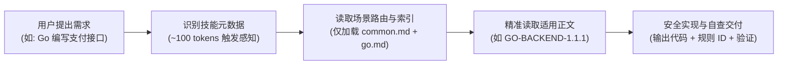

# 🛡️ Secure Coding Skill

<p align="center">
  <b>让 AI 编码助手告别安全漏洞：基于腾讯工业级安全指南，先检索规则、再编写代码、最后验证交付。</b>
</p>

<p align="center">
  <a href="./README.md">English</a> · <b>简体中文</b>
</p>

<p align="center">
  <a href="#quickstart">极速上手</a> •
  <a href="#why">痛点对比</a> •
  <a href="#features">核心特性</a> •
  <a href="#how-it-works">工作原理</a> •
  <a href="#case">实战案例</a> •
  <a href="#languages">支持语言</a> •
  <a href="#faq">常见问题</a>
</p>

<p align="center">
  <a href="https://github.com/yuhengqin/secure-coding-skill/actions/workflows/validate.yml"></a>
  <a href="#languages"></a>
  <a href="#languages"></a>
  
  <a href="LICENSE"></a>
</p>

---

<span id="why"></span>
## ⚡ 为什么需要它？（直观对比）

AI 编写代码速度极快，但在默认情况下**不会自动套用防御性安全规则**：输入是否校验、查询是否参数化、权限是否在服务端鉴权，全凭模型概率，极易产生注入或水平越权等严重缺陷。

把全套规范直接塞进 Prompt？**上下文窗口瞬间被撑爆，费用激增且会干扰模型推理。**

**Secure Coding Skill** 将腾讯成熟的 [Tencent/secguide](https://github.com/Tencent/secguide) 安全指南封装为符合标准的 **Agent Skill**，以“渐进式展开（Progressive Disclosure）”按需提供指引：

```diff
# 场景：根据用户请求中的 order_id 查询订单详情

- 普通 AI 生成代码（高危缺陷：字符串直接拼接 SQL + 水平越权）
- return connection.execute(f"SELECT * FROM orders WHERE id = '{order_id}'").fetchone()

+ 引入 secure-coding 技能后生成代码（遵循 PY-BACKEND-1.2.1 与 1.8.3）
+ # 严格校验输入格式 + 参数化绑定防 SQL 注入 + 强制服务端登录态限制订单归属
+ return connection.execute(
+     "SELECT id, note FROM orders WHERE id = ? AND user_id = ?",
+     (order_id, authenticated_user_id),
+ ).fetchone()
```

---

<span id="features"></span>
## 💡 核心特性

- 🎯 **225 条工业级规则**：覆盖 Python、JavaScript/TypeScript、Java、Go、C/C++ 五大主流语言的核心前后端与系统级开发。
- ⚡ **零上下文膨胀**：采用渐进式披露机制。初始化仅占约 100 token，只在涉及相关操作时按需加载具体规则正文，绝不爆上下文。
- 🔍 **全链路可追溯**：规则正文、上游原文行号与来源 SHA-256 哈希完整随包提供，另附 10 项适配现代框架演进的适用性解释。
- 🔌 **零第三方依赖 & 纯离线**：规则检索与完整性校验 CLI 仅使用 Python 3.10+ 标准库，不联网、不外发任何代码数据。
- 🧪 **开箱即用可验证**：内置 7 项 CLI 回归测试与 6 项可运行的安全案例测试（覆盖注入与水平越权防御）；配有跨平台 CI 矩阵。

---

<span id="quickstart"></span>
## 🚀 两步极速上手

### 第一步：将技能包安装到你的项目

选择以下任意一种方式将技能目录引入项目：

#### 方式 1：终端一行命令复制（推荐）

在你的**目标业务项目根目录**下执行：

**Linux / macOS:**
```bash
git clone --depth 1 https://github.com/yuhengqin/secure-coding-skill.git .tmp-skill \
  && mkdir -p .agents/skills \
  && cp -R .tmp-skill/skills/secure-coding .agents/skills/ \
  && rm -rf .tmp-skill
```

**Windows PowerShell:**
```powershell
git clone --depth 1 https://github.com/yuhengqin/secure-coding-skill.git .tmp-skill
New-Item -ItemType Directory -Path ".agents\skills" -Force | Out-Null
Copy-Item -LiteralPath ".\.tmp-skill\skills\secure-coding" -Destination ".agents\skills" -Recurse
Remove-Item -Path ".\.tmp-skill" -Recurse -Force
```

<details>
<summary><b>更多安装途径（AI 助手安装 / 全局安装 / 手动复制）</b></summary>

- **让 AI 助手安装（Codex / Claude Code / Cursor 等）**：克隆本仓库后，让助手阅读 [README_AI.md](README_AI.md) 完成安装与检查。
- **个人全局安装**：希望本机所有项目通用时，复制到个人全局技能目录：
  - Linux / macOS: `~/.agents/skills/secure-coding/`
  - Windows: `%USERPROFILE%\.agents\skills\secure-coding\`
- **手动复制**：保留完整 `skills/secure-coding` 目录（包含 `SKILL.md`、`LICENSE`、`NOTICE.md`、`references/` 与 `sources/`），不要只复制单个文件。

</details>

---

### 第二步：在编码对话中唤醒使用

在向 AI 提出编码需求时，直接附带调用指令（支持 Codex、Claude Code、Cursor、Windsurf 等主流工具）：

> **📋 一键复制提示词：**
> 
> “请使用 `secure-coding` 技能完成本次改动。写代码前先检索相关的输入、数据存储及鉴权规则，并在完成后说明引用的规则 ID、防护措施及实际执行的验证。”

*(在支持快捷符号的客户端中，亦可直接使用 `$secure-coding` 或 `@secure-coding` 触发)*

---

### 验证安装有效性

在**业务项目根目录**运行完整性校验（需 Python 3.10+，纯标准库，无需安装任何 pip 包）：

```bash
python .agents/skills/secure-coding/scripts/guide.py check
```

> **预期输出：** 成功校验 `225 条规则、6 份来源、10 项解释`。

---

<span id="how-it-works"></span>
## 🛠️ 工作原理：零上下文膨胀

如果将数十页规范全文塞入提示词，会挤占宝贵的上下文。本项目通过**多层渐进式路由**实现高效加载：



助手仅读取当前改动语言的规则，规则选择由模型按需驱动；本地 `guide.py` 脚本可在离线环境下根据规则 ID 瞬间返回正文与出处。

---

<span id="case"></span>
## 🧪 实战案例：订单查询

在 [examples/order-query](examples/order-query/README.md) 中，展示了如何通过该技能实现一个防御完善的 Python 订单查询接口：

- **适用规则**：`PY-BACKEND-1.1.1`（输入校验）、`PY-BACKEND-1.2.1`（参数化查询）、`PY-BACKEND-1.8.1`（默认鉴权）、`PY-BACKEND-1.8.3`（防越权）。
- **防御行为验证矩阵**：

| 输入或测试情形 | 预期安全行为 | 验证状态 |
| :--- | :--- | :---: |
| 用户查询本人的订单 | 正常返回订单明细 | ✅ 通过 |
| 尝试查询他人的订单 / 不存在的订单 | 返回 `None`，杜绝未授权访问 | ✅ 通过 |
| 恶意输入 `order-b' OR 1=1 --` | 参数绑定使输入保持为纯数据，不扩大查询范围 | ✅ 通过 |
| 合法 ID 包含单引号 | 按字面值安全处理并正常查询 | ✅ 通过 |
| 缺失/伪造身份标识、非法订单格式 | 边界预检直接拒绝查询 | ✅ 通过 |

在仓库根目录下即可运行此案例的完整测试：
```bash
python -B -m unittest discover -s examples/order-query -p test_orders.py -v
```

---

<span id="languages"></span>
## 📊 支持语言与防御焦点

适用于日常功能开发、缺陷修复、安全重构及只读代码审查：

| 语言 | 规则数 | 覆盖场景 | 重点防御领域 |
| :--- | :---: | :--- | :--- |
| **Python** | 45 | 通用业务、Web 服务端 | SQL注入、SSRF、不安全反序列化、越权访问、敏感配置泄露 |
| **JavaScript / TS** | 45 | 浏览器前端、Node.js 服务端 | XSS 跨站脚本、DOM 劫持、原型链污染、CORS 跨域错配 |
| **Java** | 49 | Spring 服务端、Android 应用 | 表达式注入 (SpEL)、XXE 外部实体注入、安全加密套件、组件反序列化 |
| **Go** | 37 | 通用后端、微服务接口 | 路径穿越、命令执行注入、并发竞态安全、内存越界访问 |
| **C / C++** | 49 | 系统底层、高性能模块 | 缓冲区溢出、整数溢出、Format String、指针双重释放 (UAF) |

> 💡 *注：TypeScript 直接复用 JavaScript 运行时安全规则。上游指南的“必须／建议／推荐”级别完整保留；针对历史框架建议，技能包额外提供了 **10 项带出处的现代适用性解释**。*

---

<span id="faq"></span>
## ❓ 常见问题 (FAQ)

<details>
<summary><b>Q1: 会大幅增加模型的 Token 消耗或 API 费用吗？</b></summary>
不会。这是 Agent Skill 规范的核心优势：未触发时仅向模型暴露技能名称与简要描述（约 100 token）。触发后，助手仅按需检索并读取当前改动涉及的规则段落，不会加载五份指南全文。
</details>

<details>
<summary><b>Q2: 我的业务项目中没有安装 Python，可以使用本技能吗？</b></summary>
完全可以。规则库本身是规整的 Markdown 文件，AI 助手可以直接通过文件读取与索引定位正文。Python 3.10+ 仅用于本地运行 `guide.py` 辅助检索、批量校验完整性或执行单元测试。
</details>

<details>
<summary><b>Q3: 本技能可以替代 SonarQube、Semgrep、Snyk 等专业扫描器吗？</b></summary>
不能。本技能的定位是<b>“源头预防与自我审校”</b>，帮助 AI 助手在生成代码的第一时间遵守防御性准则；代码合并与交付前，依然应当依赖项目原有的自动化静态分析、动态测试和人工审计流水线。
</details>

<details>
<summary><b>Q4: 支持哪些 AI 客户端与 IDE？</b></summary>
支持所有遵循 <code>.agents/skills/</code> 目录约定的客户端（如 Codex CLI / IDE）；对于 <b>Cursor</b>、<b>Claude Code</b>、<b>Windsurf</b>、<b>GitHub Copilot</b> 等工具，均可直接读取 <code>SKILL.md</code> 与规则索引作为工作区规则使用。
</details>

<details>
<summary><b>Q5: 可以只提取某一种语言的规则吗？</b></summary>
目前建议保留完整技能包。规则来源哈希校验机制针对完整规则库设计；单语言按需导出的轻量分发功能已列入后续规划。
</details>

---

## 🔍 验证状态与工程边界

本仓库坚持以事实与证据为准：

| 校验项 | 当前状态与验证证据 |
| :--- | :--- |
| **规则包完整性与 CLI** | 已在 Windows / Ubuntu 及 Python 3.10 ~ 3.14 环境验证通过 |
| **测试套件运行** | 7 项 CLI 回归测试 + 6 项实战案例测试均 100% 通过 |
| **离线与安全性** | 全流程无外部网络请求，无需第三方 pip 包，不采集任何代码 |
| **自动化发现机制** | 各客户端的自动触发灵敏度受提示词与上下文影响，推荐显式指定技能名称调用 |

完整验证记录与执行命令详见 [验证记录](docs/VALIDATION.md) 与 [使用手册](docs/USAGE.md)。

---

## 🗺️ 深入阅读与文档索引

- [命令与详细使用手册](docs/USAGE.md)
- [多场景提示词模板与审查示例](examples/USAGE.md)
- [规则来源与上游追溯记录](docs/PROVENANCE.md)
- [代码与规则维护说明](docs/MAINTENANCE.md)
- [版本发布与校验流程](docs/RELEASING.md)
- [版本更新记录](CHANGELOG.md)
- [AI 助手安装专用指引](README_AI.md)

---

## 📜 来源与开源协议

- **原始著作权**：本项目规则基于 **Secure Coding Guide** 整理，作者及版权方为 **THL A29 Limited, a Tencent company**，Copyright (C) 2021。
- **原项目地址**：[Tencent/secguide](https://github.com/Tencent/secguide)。
- **本项目许可**：本项目基于 **CC BY-SA 4.0** 许可证开源分发，保留上游完整 [LICENSE](LICENSE)。
- **免责声明**：本项目是独立的开源社区封装与工程实践，未获得腾讯官方背书或赞助。具体修改、适配与解释说明详见 [第三方声明](THIRD_PARTY_NOTICES.md) 与 [NOTICE.md](skills/secure-coding/NOTICE.md)。

---

<p align="center">
  如果这个项目对你的日常安全编码有所帮助，欢迎点亮右上角的 ⭐️ <b>Star</b> 支持！<br>
  发现规则需要补充或适应现代新特性？欢迎提交 <a href="https://github.com/yuhengqin/secure-coding-skill/issues/new/choose">Issue</a> 或发起 <a href="CONTRIBUTING.md">Pull Request</a>。
</p>
