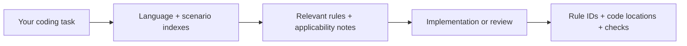

<p align="center">
  
</p>

<h1 align="center">🛡️ Secure Coding Skill</h1>

<p align="center">
  <b>Eliminate security blind spots in AI coding.<br>Retrieve the rules. Build the defenses. Show the evidence.</b>
</p>

<p align="center">
  <a href="./README.md">简体中文</a> · <b>English</b>
</p>

<p align="center">
  <a href="#case">See It in Action</a> · <a href="#evidence">End-to-End Evidence</a> · <a href="#quickstart">Quickstart</a> · <a href="#use-cases">Use Cases</a> · <a href="#features">Features</a> · <a href="#compatibility">Compatibility</a> · <a href="#faq">FAQ</a>
</p>

<p align="center">
  <a href="https://github.com/yuhengqin/secure-coding-skill/stargazers"></a>
  <a href="#languages"></a>
  <a href="#languages"></a>
  
  <a href="./LICENSE"></a>
</p>

> 🤖 **You're an AI agent (Claude / Codex / OpenCode / Cursor)?** Read [`README_AI.md`](./README_AI.md) to install and make your first call; repo navigation lives in [`AGENTS.md`](./AGENTS.md) / [`CLAUDE.md`](./CLAUDE.md). (Those two files are in Chinese; the install steps are copy-paste ready.)

**Put 225 security rules to work in your next AI coding session.** Secure Coding Skill turns [Tencent/secguide](https://github.com/Tencent/secguide) into an Agent Skill: your coding assistant retrieves relevant rules, applies them to the change, and reports rule IDs, code locations, and checks performed. Built for everyday development, fixes, refactoring, and code review.

<span id="case"></span>

## 🧪 See It in Action: Only Read Your Own Orders

**The request:** “Implement an order lookup in Python. Use the existing authenticated identity, let users read only their own orders, and check input, SQL, and authorization boundaries.”

The [runnable order-query example](./examples/order-query/README.md) follows the whole path: **request → rules → implementation → tests**.

```diff
# Illustrative query comparison; full input checks are in orders.py.

- # Unsafe pattern: SQL string interpolation, no ownership constraint
- return connection.execute(f"SELECT * FROM orders WHERE id = '{order_id}'").fetchone()

+ # PY-BACKEND-1.2.1 + PY-BACKEND-1.8.3: bind values and constrain ownership
+ return connection.execute(
+     "SELECT id, note FROM orders WHERE id = ? AND user_id = ?",
+     (order_id, authenticated_user_id),
+ ).fetchone()
```

| What you get | In this example |
| :--- | :--- |
| **Rules with a reason** | `PY-BACKEND-1.1.1` input validation; `PY-BACKEND-1.2.1` parameter binding; `PY-BACKEND-1.8.1` default authorization; `PY-BACKEND-1.8.3` object ownership |
| **Concrete defenses** | Input checks + SQL parameters + an ownership condition using a server-verified identity |
| **Executable evidence** | 6 tests covering own/other/missing orders, injection-shaped input and literal quotes, invalid identity values, and invalid order IDs |

**Try the evidence yourself** — from this repository root, with Python 3.10+ and standard-library `sqlite3`:

```bash
python -B -m unittest discover -s examples/order-query -p test_orders.py -v
```

The example passes all 6 tests locally. The comparison illustrates the rules; it is not a measured model A/B result. The caller must authenticate the user; HTTP authentication, operation-level permissions, and real database integration are outside this example. [Full implementation and test scope →](./examples/order-query/README.md)

<span id="evidence"></span>

## 📡 End-to-End Evidence (2026-10-16, real output)

Everything below is verbatim output from running this repository in a real environment.

**① Explicit skill invocation in OpenCode, loaded successfully:**

```
⏺ skill({"id":"secure-coding"})
  ⏺ Skill "secure-coding" loaded successfully
    Base directory: D:\chat\.agents\skills\secure-coding
```

**② Fresh install via skills CLI — 25/25 files match the repository:**

```bash
npx -y skills add yuhengqin/secure-coding-skill -a opencode --copy -y
```

Every installed file matches this repository byte-for-byte by SHA-256, and passes the integrity check below.

**③ Integrity check (`guide.py check`):**

```console
$ python skills/secure-coding/scripts/guide.py check
{
  "status": "ok",
  "rules": 225,
  "by_language": {
    "python": 45,
    "javascript": 45,
    "java": 49,
    "go": 37,
    "cpp": 49
  },
  "sources": 6,
  "interpretations": 10,
  "scope": "package integrity only; not a target-code security scan"
}
```

**④ Rule lookup (`guide.py show`) with source line numbers and hash:**

```console
$ python skills/secure-coding/scripts/guide.py show PY-BACKEND-1.2.1
# PY-BACKEND-1.2.1 [必须] 使用参数化查询
Context: 后台类 / I. 代码实现 / 1.2 SQL操作
Source: sources/Python安全指南.md:177-262 sha256=b1d1f0b7…

Original excerpt (historical examples; apply interpretations and verify applicability):
177  #### 1.2.1 【必须】使用参数化查询
179  - 使用参数化SQL语句，强制区分数据和命令，避免产生SQL注入漏洞。
…
```

**⑤ Test evidence:**

```console
$ python -m unittest discover -s skills/secure-coding/tests -v
Ran 7 tests in 0.457s
OK

$ python -B -m unittest discover -s examples/order-query -p test_orders.py -v
Ran 6 tests in 0.001s
OK
```

> Note: `check` validates package integrity (hashes, coverage, generated files). It is not a security scan of your business code, and it does not prove the AI will auto-invoke the skill.

<span id="quickstart"></span>

## 🚀 Quickstart in 2 Steps

### 1. Install

Run in your **target project's root** and select your coding agent. Requires Node.js with `npx`; Python is optional for reading the Markdown rules directly.

```bash
npx skills add yuhengqin/secure-coding-skill
```

### 2. Put It to Work

Ask your assistant to apply the skill to a real task. For a project with order queries, try:

```text
Use the secure-coding skill to implement or review the order lookup in this project.
Users must only read their own orders. Retrieve the relevant input validation,
SQL, and authorization rules first. Then report rule IDs, code locations,
defenses, checks actually run, and anything still unverified.
```

**What to look for:** the assistant reads applicable rules and ties its result to code and checks. To confirm discovery separately, ask it to locate `secure-coding` and read `PY-BACKEND-1.2.1`. If it cannot find the skill, check the installation directory and reopen the project. Explicit invocation is recommended.

<details>
<summary><b>Optional: verify the installed rule package</b></summary>

With Python 3.10+, run this from your project root. Replace the path with the actual installed location if your agent uses another directory.

```bash
python .agents/skills/secure-coding/scripts/guide.py check
```

Expected: `"status": "ok"`, **225 rules, 6 sources, 10 interpretations**. This checks package integrity; client invocation is a separate check (see the end-to-end evidence above).

</details>

<details>
<summary><b>More install options, updates, and removal</b></summary>

| Need | Command or guide |
| :--- | :--- |
| Preview available skills | `npx skills add yuhengqin/secure-coding-skill --list` |
| Choose agents explicitly | `npx skills add yuhengqin/secure-coding-skill --agent codex --agent claude-code` |
| Install for all your projects | `npx skills add yuhengqin/secure-coding-skill -g` |
| Update / remove a project install | `npx skills update secure-coding` / `npx skills remove secure-coding` |
| Update / remove a global install | Add `-g` to the update or remove command |
| Install without Node.js | [Manual installation: Linux, macOS, and PowerShell](./docs/INSTALLATION.md) |
| Let an assistant install it | [AI installation handoff guide](./README_AI.md) (Chinese) |

The [skills CLI](https://github.com/vercel-labs/skills) handles agent-specific destinations. Manual installs must keep the entire `skills/secure-coding/` package, including its license and sources. Before replacing a manual installation, compare and preserve local changes; run `guide.py check` after updating.

</details>

<span id="routing"></span>

## 🧭 Not Sure Where to Start? Find Yourself

| You are… | You want to… | Go here |
| :--- | :--- | :--- |
| 🤖 AI agent | Install, verify, first call | [`README_AI.md`](./README_AI.md) |
| 🤖 AI agent | Understand repo layout & guardrails | [`AGENTS.md`](./AGENTS.md) / [`CLAUDE.md`](./CLAUDE.md) |
| 👤 Human (first visit) | Get it running in 2 min | [Quickstart](#quickstart) |
| 👤 Human (on OpenCode) | End-to-end workflow | [`docs/USAGE.md`](./docs/USAGE.md) |
| 🔧 Manual install | Pick agent & platform | [`docs/INSTALLATION.md`](./docs/INSTALLATION.md) |
| 📖 Looking up a rule | Exact rule lookup | `guide.py show <rule-id>` |
| 🔍 Verifying rule sources | Check hashes & provenance | [`docs/PROVENANCE.md`](./docs/PROVENANCE.md) · [`docs/VALIDATION.md`](./docs/VALIDATION.md) |
| 🧩 Maintaining or releasing | Build & release process | [`docs/MAINTENANCE.md`](./docs/MAINTENANCE.md) · [`docs/RELEASING.md`](./docs/RELEASING.md) |
| 🤝 Contributing | Open an issue / PR | [`CONTRIBUTING.md`](./CONTRIBUTING.md) · [Issue templates](./.github/ISSUE_TEMPLATE) |

<span id="use-cases"></span>

## 🎯 When to Reach for It

| Your task | Rules and checks to bring into the change |
| :--- | :--- |
| Build an API or database query | Input validation, parameter binding, authentication and object ownership |
| Handle uploads, downloads, or user-provided URLs | Path boundaries, file constraints, SSRF and redirect handling |
| Render HTML or change browser behavior | XSS, output context, DOM operations and browser security boundaries |
| Start processes or deserialize data | Command arguments, execution boundaries and untrusted input |
| Refactor or review existing code | Relevant rule IDs, code evidence, targeted checks and remaining gaps |

<span id="features"></span>

## 🔥 Why This Skill? Security Firepower, Ready to Load

AI coding moves fast. Input boundaries, SQL parameters, and object permissions deserve a place in that workflow from the first change. **Put the security playbook within your assistant's reach.**

- 🎯 **225 industrial rules, one skill.** Python, JavaScript/TypeScript, Java, Go, and C/C++ in a single installable package.
- 🪶 **Full firepower, light context.** Progressive disclosure routes the assistant through language and task indexes to the rule bodies it needs — no five full guides up front.
- 🔍 **Every rule has a trail.** Original text, line numbers, and source SHA-256 hashes, plus 10 sourced applicability notes for selected historical guidance.
- 🔌 **Zero third-party CLI dependencies.** Python 3.10+ standard library handles local lookup and integrity checks — no network requests, no code collection.
- 🧪 **Show the checks.** 7 tool regression tests and 6 runnable example tests, with commands you can repeat yourself.

### From Task to Evidence



The model selects applicable rules; `guide.py` retrieves their text and provenance locally. The skill also asks the assistant to check current APIs and project constraints when applying historical examples. [Explore the workflow →](./skills/secure-coding/SKILL.md)

<span id="languages"></span>

## 📊 Languages & Coverage

| Language | Rules | Environments and focus |
| :--- | :---: | :--- |
| **Python** | 45 | Scripts and backend services: SQLi, SSRF, deserialization, access control |
| **JavaScript / TypeScript** | 45 | Browsers and Node.js: XSS, DOM security, prototype pollution, CORS |
| **Java** | 49 | Backend services and Android: expression injection, XXE, cryptography |
| **Go** | 37 | Backend and systems code: paths, commands, concurrency, resource limits |
| **C / C++** | 49 | Native code: buffer and integer overflows, format strings, memory lifetime |

TypeScript uses the JavaScript runtime rules. Original **MUST / SHOULD / RECOMMENDED** levels are preserved. The 10 applicability notes address specific historical recommendations; the full rule set has not undergone a complete modernization audit.

<span id="compatibility"></span>

## 🔌 Client Compatibility

| Client / installation route | Package installation | Discovery and actual invocation |
| :--- | :--- | :--- |
| **OpenCode via skills CLI** | Windows, 2026-10-16: `-a opencode --copy -y`; 25/25 files match; installed package passes `check` | ✅ End-to-end verified (2026-10-16, explicit invocation loaded successfully — see [evidence](#evidence)) |
| **Codex, Claude Code, Cursor, GitHub Copilot, other skills CLI agents** | Installation routes provided by the upstream CLI; not individually tested here | Not yet verified end-to-end; verification records welcome |
| **Manual copy** | Complete-package copying and installed CLI use verified; use your client's documented directory | Depends on the client's loading mechanism |

Use the installer's reported location. The shared project path is commonly `.agents/skills/secure-coding/`; agent-specific paths can differ. [Installation details →](./docs/INSTALLATION.md) · [Validation records →](./docs/VALIDATION.md)

<span id="validation"></span>

## ✅ Validation You Can Inspect

| Check | Recorded result |
| :--- | :--- |
| Rule package integrity | **Pass locally:** 225 rules, 6 sources, 10 interpretations (hashes, coverage, generated files all consistent) |
| Tool and example tests | **7 + 6 passed** on Windows / Python 3.14.2 |
| OpenCode end-to-end invocation | **Verified:** explicit `secure-coding` invocation loaded successfully (2026-10-16) |
| Fresh install via skills CLI | **Verified:** 25/25 file hashes match; installed package passes `check` (2026-10-16) |
| Remote CI | Windows / Ubuntu × Python 3.10 / 3.14 configured; execution pending after an account billing block |
| Model security improvement | No controlled comparison against an unassisted baseline yet |

Package integrity and example tests cover their stated scope. Project security still needs project tests, scanners, and review. [Commands and full evidence →](./docs/VALIDATION.md)

<span id="repo"></span>

## 🗂️ Repository Layout

```
secure-coding-skill/
├── README.md                  ← Chinese README (default homepage)
├── README_EN.md               ← this file (English)
├── README_AI.md               ← AI-agent installation handoff (Chinese)
├── AGENTS.md / CLAUDE.md      ← agent navigation (Claude / Codex / OpenCode / Cursor)
├── assets/banner.svg          ← visual anchor
├── skills/secure-coding/      ← the installable skill package
│   ├── SKILL.md               ← skill entry (agents read this first)
│   ├── scripts/guide.py       ← zero-dep CLI: check / show / list / build
│   ├── references/            ← language indexes, scenario routing, rule metadata
│   ├── sources/               ← vendored source snapshots + provenance manifests
│   └── tests/                 ← 7 tool regression tests
├── examples/order-query/      ← runnable case: order lookup (6 tests)
├── docs/                      ← installation / usage / provenance / validation / maintenance / releasing
├── .github/workflows/         ← remote validation workflow (pending billing resolution)
└── THIRD_PARTY_NOTICES.md     ← third-party notices
```

<span id="faq"></span>

## ❓ FAQ

<details>
<summary><b>Does my project need Python?</b></summary>

No. An assistant can read the Markdown rules directly. Python 3.10+ is needed only to run the local lookup, package checks, and tests.

</details>

<details>
<summary><b>How much context does it use?</b></summary>

The skill is organized for progressive disclosure: metadata for discovery, then instructions, indexes, and relevant rules when invoked. Actual token use depends on the client and task; this repository does not publish a measured token budget.

</details>

<details>
<summary><b>Does it replace security scanners or keep my AI client offline?</b></summary>

It guides generation and review; keep your project's static analysis, dynamic tests, and human review. The local CLI makes no network requests. Your coding assistant's model calls and data handling still follow that client's settings and provider terms.

</details>

<details>
<summary><b>Can I install only one language?</b></summary>

Keep the complete package today: integrity checks cover the full rule set. The assistant can still read rules selectively. Single-language export is on the roadmap.

</details>

<details>
<summary><b>Are the rules AI-hallucinated?</b></summary>

No. Rules come from the secguide originals; the repository vendors the source snapshots with SHA-256 hashes, and `guide.py check` verifies every one. Every rule maps back to exact source line numbers. The skill also instructs assistants to report checks and unverified items honestly, never presenting guesses as passes.

</details>

<span id="roadmap"></span>

## 🤝 Contribute & What's Next

Useful contributions include **client verification records**, **rule corrections with current sources**, and **runnable examples with meaningful tests**. Start with [CONTRIBUTING.md](./CONTRIBUTING.md); report exploitable tool defects through [SECURITY.md](./SECURITY.md).

- ✅ OpenCode end-to-end invocation verified (2026-10-16)
- ⬜ End-to-end verification for the remaining clients (Claude Code / Codex / Cursor)
- ⬜ First green remote CI run and a versioned release
- ⬜ More sourced applicability notes and runnable cases
- ⬜ Single-language exports and additional client adapters

## 📚 Go Deeper

| Want to know | Start here |
| :--- | :--- |
| Let an AI assistant install it | [AI handoff guide](./README_AI.md) · [Agent navigation](./AGENTS.md) |
| Install manually | [Installation guide](./docs/INSTALLATION.md) |
| Query rules and run checks | [Command reference](./docs/USAGE.md) |
| More development and review prompts | [Usage examples](./examples/USAGE.md) |
| Inspect original sources and modifications | [Provenance](./docs/PROVENANCE.md) · [Third-party notices](./THIRD_PARTY_NOTICES.md) |
| Maintain or release the package | [Maintenance](./docs/MAINTENANCE.md) · [Releasing](./docs/RELEASING.md) · [Changelog](./CHANGELOG.md) |

The installable package lives in `skills/secure-coding/`; the runnable demo lives in `examples/order-query/`. Most supporting documents are in Chinese.

## 📜 Attribution & License

Based on **Secure Coding Guide** by **THL A29 Limited, a Tencent company**, Copyright (C) 2021. Distributed under **[CC BY-SA 4.0](./LICENSE)** with upstream attribution and modification notices preserved (see [NOTICE](./skills/secure-coding/NOTICE.md)). This is an independent community project, not officially endorsed by Tencent. Keep `LICENSE`, `NOTICE.md`, and source files with the installed package.

<p align="center">
  Bring security into your next AI coding session.<br>
  If it helps, give the project a ⭐️ <b>Star</b>, share a real use case, or <a href="https://github.com/yuhengqin/secure-coding-skill/issues/new/choose">open an issue</a>.
</p>
